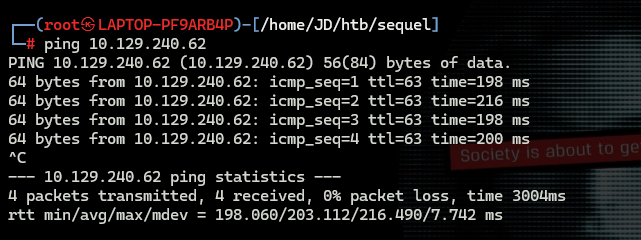
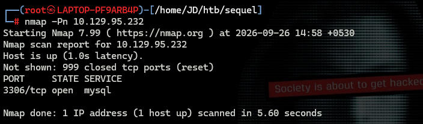
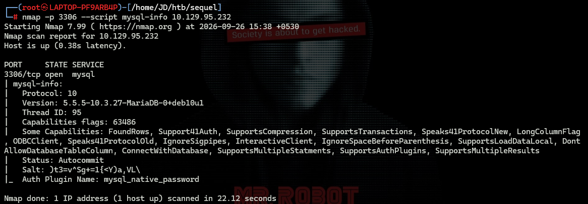
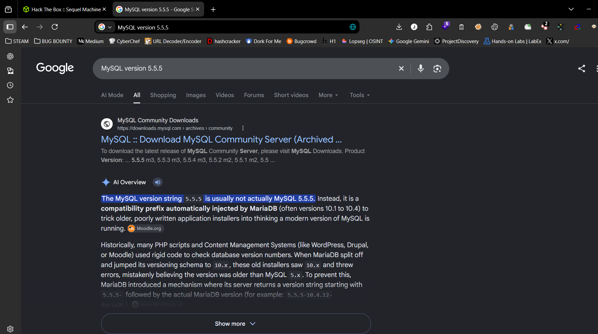
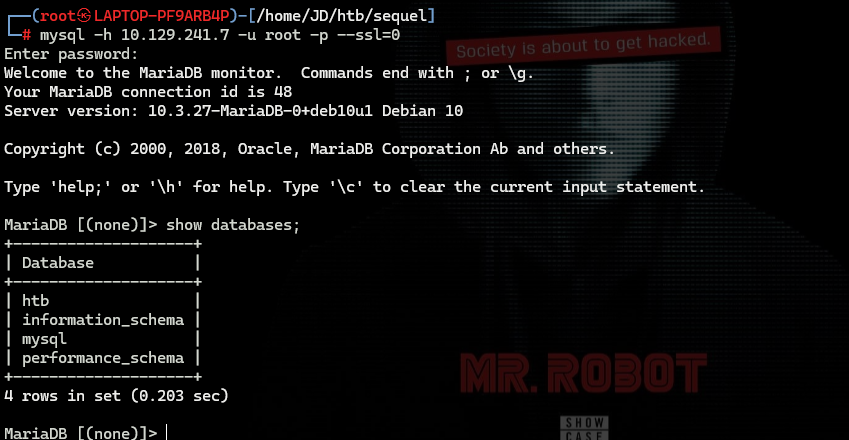
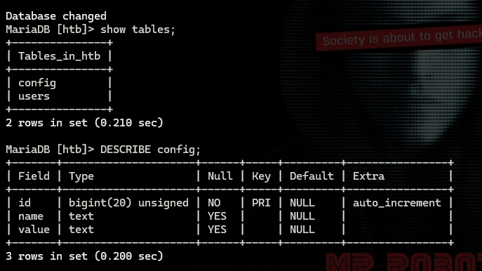
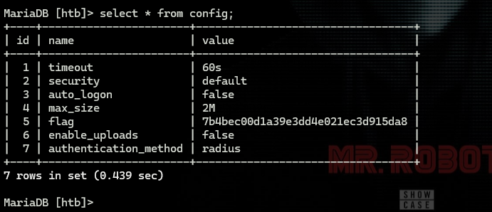

# Sequel — Hack The Box

**Platform:** Hack The Box  
**Room:** Sequel  
**Category:** Web Application Basics  
**Difficulty:** Beginner  
**Status:** ✅ Completed

---

## Overview

The **Sequel** room on Hack The Box introduces the fundamentals of MySQL and MariaDB enumeration. The objective is to identify the database service running on the target, connect to it using the MySQL command-line client, explore databases and tables, and retrieve the flag.

This lab helped me practice basic network scanning with Nmap, service enumeration, database authentication, and SQL commands used to inspect database structures and retrieve data.

### Methodology

1. Connect to the Hack The Box VPN and start the target machine.
2. Verify that the target is reachable.
3. Scan the target to identify the MySQL service and its port.
4. Enumerate the service to identify the database version.
5. Connect to the database using the MySQL client.
6. Explore databases, tables, and columns.
7. Retrieve the flag from the appropriate table.

---

## Task 1 — Identify the MySQL Port

**Question:** During our scan, which port do we find serving MySQL?

**Answer:**
```text
3306
```

### Explanation

After connecting to the Hack The Box VPN and starting the target machine, I first checked whether the target was reachable using `ping`.

```bash
ping <machine-ip>
```

This sends ICMP echo requests to the target and helps determine whether it responds to network connectivity checks.



Next, I used Nmap to scan the target and identify the port running the MySQL service.

```bash
nmap -Pn <machine-ip>
```

The `-Pn` option skips host discovery and treats the target as online, allowing Nmap to proceed directly with port scanning. This can be useful when a target does not respond to ping or other host-discovery probes.

The scan identified **port 3306**, the default port commonly used by MySQL and MariaDB.



---

## Task 2 — Identify the Database Version

**Question:** What community-developed MySQL version is the target running?

**Answer:**
```text
MariaDB
```

### Explanation

After identifying port 3306, I performed service enumeration to gather more information about the database service.

```bash
nmap -p 3306 --script mysql-info <machine-ip>
```

The command uses the following options:

- `-p 3306`: Scans only port 3306.
- `--script mysql-info`: Runs Nmap's MySQL information script to gather details exposed by the service.

The enumeration results indicated that the target was running **MariaDB**, a community-developed relational database management system compatible with MySQL.



I also cross-checked the information using Google to understand the database version and its relationship to MySQL.



---

## Task 3 — Specify the Login Username

**Question:** When using the MySQL command-line client, what switch do we need to use in order to specify a login username?

**Answer:**
```text
-u
```

### Explanation

The MySQL command-line client uses the `-u` option to specify the username for authentication.

For example:

```bash
mysql -h <machine-ip> -u root
```

Here:

- `mysql` launches the MySQL command-line client.
- `-h <machine-ip>` specifies the database server's host address.
- `-u root` specifies `root` as the username.

The username option is important because a database server may have different accounts with different privileges.

---

## Task 4 — Identify the Username for Passwordless Access

**Question:** Which username allows us to log into this MariaDB instance without providing a password?

**Answer:**
```text
root
```

### Explanation

The task provided the hint **"the root of all evil"**, which pointed toward the `root` username.

I used the following command to connect to the target's MariaDB service:

```bash
mysql -h <machine-ip> -u root -p --ssl=0
```

Command breakdown:

- `-h <machine-ip>` specifies the target database server.
- `-u root` specifies the `root` account.
- `-p` requests password-based authentication through the client.
- `--ssl=0` disables SSL for the client connection.

The connection was successful without requiring a password, allowing me to interact with the database.

**Note:** The `-p` option normally prompts for a password. In this lab, the target permitted the `root` account to connect without one. Disabling SSL is specific to the connection requirements of this lab and should not be treated as a general security recommendation.

---

## Task 5 — Display All Columns in a Query

**Question:** In SQL, what symbol can we use to specify within the query that we want to display everything inside a table?

**Answer:**
```text
*
```

### Explanation

In SQL, the asterisk (`*`) is used in a `SELECT` statement to request all columns from the selected table.

For example:

```sql
SELECT * FROM config;
```

This query retrieves all columns for the rows in the `config` table.

The `*` symbol is useful during database enumeration because it allows us to inspect the available records without specifying each column individually.

---

## Task 6 — Terminate an SQL Query

**Question:** In SQL, what symbol do we need to end each query with?

**Answer:**
```text
;
```

### Explanation

The semicolon (`;`) is commonly used to terminate SQL statements in the MySQL command-line client.

For example:

```sql
SHOW DATABASES;
```

The semicolon marks the end of the SQL statement so the client can execute it. Although some SQL interfaces accept statements without a semicolon, using one is standard practice when working interactively in the MySQL client.

---

## Task 7 — Identify the Unique Database

**Question:** There are three databases in this MySQL instance that are common across all MySQL instances. What is the name of the fourth that's unique to this host?

**Answer:**
```text
htb
```

### Explanation

After successfully connecting to MariaDB, I listed the databases available on the target.

```sql
SHOW DATABASES;
```

This command displays the databases accessible to the connected account.

The output included the standard system databases and an additional database named `htb`. Since `htb` was the database specific to this target, it was the answer to the task.



---

## Task 8 — Select a Database

**Question:** What is the command in MySQL to select a database to interact with?

**Answer:**
```text
use
```

### Explanation

The `USE` statement selects a database as the current database for subsequent queries.

After identifying the `htb` database, I selected it using:

```sql
USE htb;
```

Once selected, SQL statements such as `SHOW TABLES;` can be executed against the current database without specifying its name in every query.

---

## Task 9 — Inspect the Columns of a Table

**Question:** What is the command in MySQL to show the different columns for a given table?

**Answer:**
```text
DESCRIBE
```

### Explanation

The `DESCRIBE` command displays the structure of a table, including its column names, data types, and other metadata.

I first listed the tables inside the selected database:

```sql
SHOW TABLES;
```

The output showed two tables:

- `config`
- `users`

To inspect a table's structure, I used:

```sql
DESCRIBE config;
```

This helped me understand which columns were available and where relevant information might be stored.

The `DESCRIBE` command is useful during database enumeration because understanding a table's structure helps determine which queries to run next.



---

## Task 10 — Identify the Table Containing the Flag

**Question:** Which table has an entry that contains a value called flag in one of its columns?

**Answer:**
```text
config
```

### Explanation

After discovering the `config` and `users` tables, I investigated the `config` table to locate the flag.

I used the following SQL query:

```sql
SELECT * FROM config;
```

This query retrieves all rows and columns from the `config` table. The output contained the flag, confirming that `config` was the table required by the task.

This step demonstrated how to use the information obtained during database enumeration to inspect relevant records and retrieve a specific value.



---

## Flag Submission

**Submitted flag:**

```text
7b4bec00d1a39e3dd4e021ec3d915da8
```

The flag was retrieved from the `config` table, and the room was completed successfully.

---

## What I Learned

- **Network discovery:** Used `ping` to check target reachability and Nmap to identify open ports.
- **Service enumeration:** Used the `mysql-info` NSE script to gather information about the database service.
- **Database identification:** Learned to recognize MariaDB and its compatibility with MySQL.
- **Database connectivity:** Practiced connecting to a remote database using the MySQL command-line client.
- **Authentication basics:** Learned how to specify a username and how passwordless authentication can work in a lab environment.
- **SQL fundamentals:** Practiced `SHOW DATABASES`, `USE`, `SHOW TABLES`, `DESCRIBE`, and `SELECT`.
- **Database enumeration:** Learned to move from identifying a service to examining its databases, tables, columns, and records.
- **Methodical investigation:** Used information gathered at each stage to decide what to inspect next rather than guessing where the flag was stored.

## Conclusion

The Sequel room provided practical experience with basic MySQL and MariaDB enumeration. By combining Nmap service discovery with database commands, I identified the target's database service, connected to it, explored its structure, and retrieved the flag.

This lab reinforced the importance of understanding network services and database fundamentals as part of a cybersecurity learning journey.

---

## Room Status

| Platform | Room | Difficulty | Status |
|---|---|---|---|
| Hack The Box | Sequel | Beginner | ✅ Completed |

### Completion Screenshot


